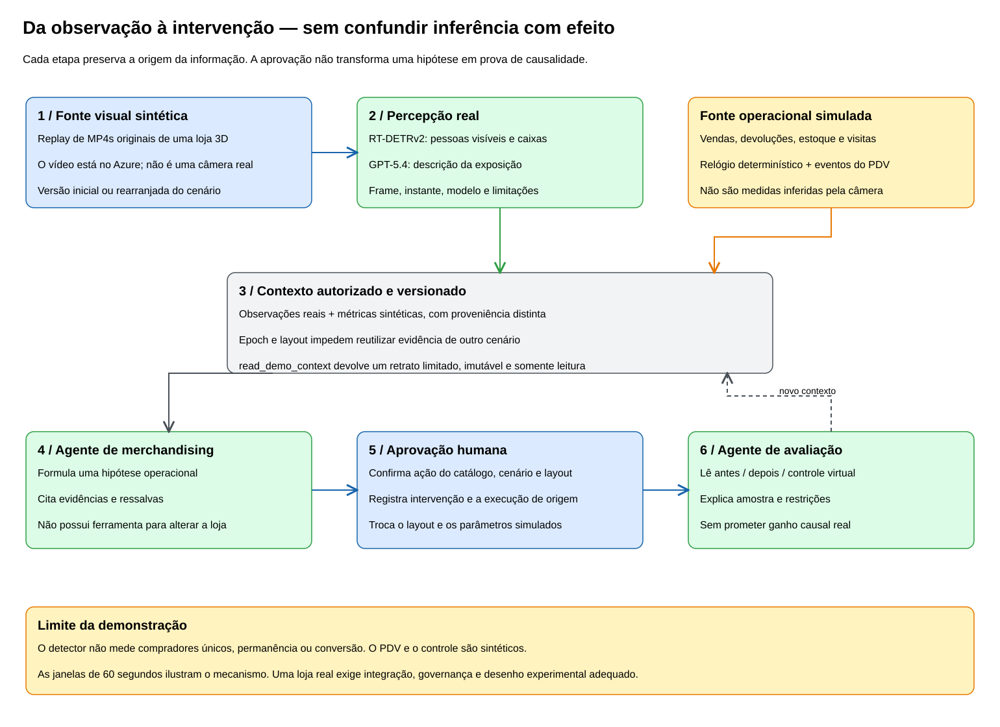
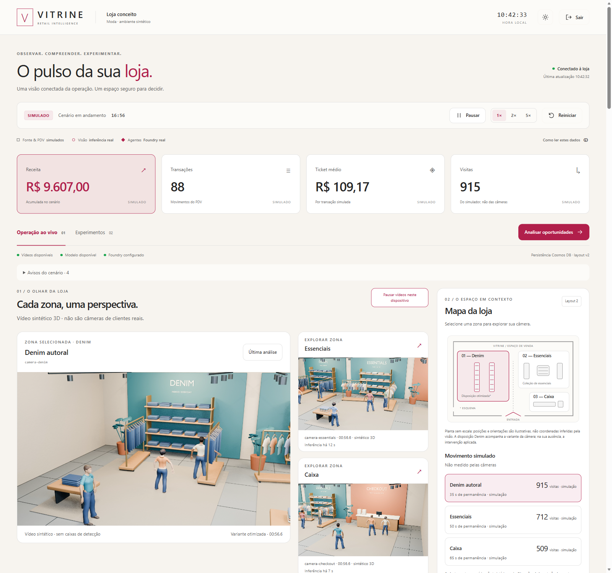
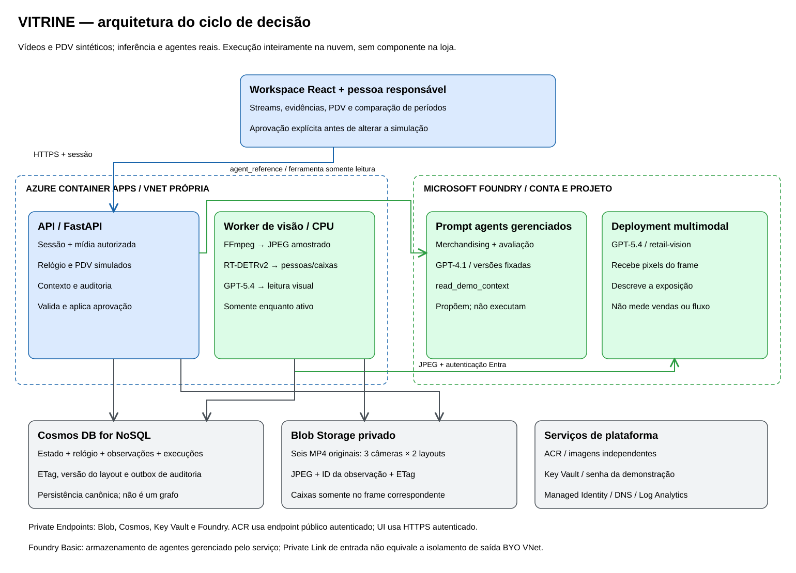

# VITRINE — da observação visual à decisão assistida no varejo

## Ver a loja não é entender suas vendas

Uma câmera pode mostrar pessoas diante de uma arara. Não mostra, por si só, se encontraram o tamanho desejado, se compraram ou por que deixaram de comprar. Um sistema de vendas registra transações, mas não explica como a disposição dos produtos aparece para quem percorre a loja. **Imagem e operação oferecem evidências diferentes; nenhuma delas substitui a outra.**

O VITRINE explora como aproximar essas evidências sem confundir observação com explicação. A pergunta deixa de ser apenas “quantas pessoas aparecem?” e passa a ser “o que podemos examinar, com esse contexto, antes de decidir uma intervenção?”. A IA ajuda a formular uma hipótese e uma recomendação; uma pessoa revisa as limitações e autoriza uma ação delimitada.

O objetivo não é transformar uma câmera em caixa registradora, nem atribuir uma venda a uma pessoa observada. É demonstrar um fluxo no qual **cada recomendação preserva sua origem, explicita o que não sabe e permanece separada da execução**.

### Observar → contextualizar → recomendar → aprovar → acompanhar

1. **Observar:** detectar pessoas visíveis em uma imagem e obter uma descrição qualitativa dessa mesma fonte visual.
2. **Contextualizar:** reunir observações e indicadores operacionais, identificando quais vieram de modelos e quais pertencem à simulação.
3. **Recomendar:** consultar agentes registrados, com acesso somente de leitura a um retrato autorizado do cenário.
4. **Aprovar:** conferir a recomendação e validar se ela ainda se aplica ao cenário e ao layout atuais.
5. **Acompanhar:** registrar a intervenção e comparar janelas simuladas, sem apresentar efeitos programados como comprovação comercial.



Por exemplo, uma equipe poderia investigar a orientação de uma exposição de denim, ou avaliar a reposição da seção Essentials. Esses são **exemplos de perguntas e ações do catálogo**, não relatos de resultados em uma loja real. Uma descrição visual pode ajudar a examinar a exposição; não comprova ruptura de estoque ou perda de vendas.

### O que torna essa abordagem um pattern

O elemento reutilizável é a separação entre **percepção, contexto, aconselhamento, autorização e execução**. O detector não conhece vendas. O modelo multimodal não recebe a verdade da simulação. O agente consulta contexto identificado por origem, mas não possui uma ferramenta de escrita. A aplicação, e não o texto gerado, decide se uma ação aprovada é válida.

Essa organização permite trocar modelos e fontes operacionais sem dar a um único componente autoridade para observar, interpretar e agir sem revisão. O mesmo princípio pode orientar inspeção industrial, operações de armazéns ou manutenção: adaptar as evidências e o catálogo de ações, preservando os limites de cada etapa.

### Patterns replicáveis

| Pattern | Aplicação concreta |
|---|---|
| Percepção separada de raciocínio | Um detector mede pessoas visíveis; um modelo multimodal descreve a exposição; agentes interpretam o contexto. |
| Proveniência como contrato | Vídeo sintético, inferência real e métricas simuladas mantêm identificadores e origens distintas. |
| Contexto limitado por execução | Uma ferramenta somente de leitura entrega um snapshot autorizado, não acesso irrestrito aos sistemas. |
| Recomendação separada de comando | Texto gerado não vira código; a API aceita somente ações previamente cadastradas e aprovadas. |
| Evidência temporal e versionada | Frame, observação, epoch e layout impedem combinar dados de momentos ou cenários diferentes. |
| Estado transacional e outbox | Relógio e estado avançam juntos; auditoria entre partições é persistida e encaminhada com controle de concorrência. |
| Acompanhamento sem causalidade presumida | Antes/depois e controle ilustram a avaliação, mas não transformam uma simulação em evidência de resultado real. |

## Da ideia à implementação

Aplicação de referência **cloud-only** para uma loja de moda fictícia, VITRINE. FastAPI e React compartilham a mesma origem no Azure Container Apps; um worker privado executa visão computacional; Microsoft Foundry fornece a leitura multimodal e os agentes de aconselhamento.

As três câmeras da interface reproduzem loops originalmente renderizados em 3D. Há nove atores sintéticos anônimos na cena, sem imagens de pessoas reais. Cada câmera possui variantes `baseline` e `optimized`: **seis MP4s de 60 segundos, 1280 × 720, 15 fps**. As trajetórias dos atores são controladas; a variante visual inclui a reorientação da exposição de denim.

Não há conexão RTSP, câmera física, integração com varejista, ERP ou ponto de venda. A execução completa acontece na nuvem; a autoria de mídia e os testes podem ser realizados localmente.



*Interface da aplicação. Os vídeos são sintéticos; as inferências sobre suas imagens são reais. Os indicadores de operação são simulados.*

### Simulado, real e não implementado

| Camada | O que existe | Limite de interpretação |
|---|---|---|
| Loja e mídia | Cena 3D original, nove atores sintéticos, três câmeras e duas variantes. | Não representa uma operação comercial observada. |
| Operação | Visitas, permanência, estoque, vendas, devoluções e efeitos das intervenções simulados. | Não são medições do detector nem transações reais. |
| Detecção | RT-DETRv2-R18 executa inferência real em JPEGs extraídos dos MP4s. | Contagens por imagem e caixas, não visitantes únicos. |
| Leitura qualitativa | GPT-5.4 recebe o JPEG e produz uma resposta estruturada. | Interpretação de uma imagem, sujeita a erro e oclusão. |
| Aconselhamento | Agentes gerenciados no Foundry consultam contexto e propõem ações. | Não executam alterações na loja. |
| Aprovação e persistência | API autenticada valida ações; Cosmos DB e Blob armazenam estado e evidências. | A intervenção altera somente a simulação. |
| Não implementado | RTSP, rastreamento entre frames/câmeras, identidade, demografia, integração POS/ERP, SSO corporativo e RBAC de usuários. | Não inferir essas capacidades a partir da interface. |

## Arquitetura e responsabilidades



Os diagramas também estão disponíveis como fontes editáveis: [arquitetura](docs/images/architecture.excalidraw) e [ciclo de decisão](docs/images/decision-loop.excalidraw). `node .\scripts\Render-PatternDiagrams.mjs` regenera os SVGs e os arquivos Excalidraw.

| Componente | Responsabilidade |
|---|---|
| React + TypeScript | Workspace, reprodução dos loops, inspeção de imagens, recomendações e aprovação. Consulta snapshots a cada 2 segundos. |
| FastAPI / Container Apps | Serve a UI, autentica, mantém o relógio da simulação, monta contexto e valida intervenções. |
| Worker / Container Apps | Extrai JPEGs com FFmpeg, executa RT-DETR em CPU e solicita leitura multimodal. Sem ingress. |
| Microsoft Foundry | Deployment `retail-vision` com GPT-5.4; deployment `retail-agent` com GPT-4.1; definições e versões dos agentes gerenciados. |
| Cosmos DB for NoSQL | Estado durável, relógio, observações, configuração dos agentes e auditoria limitada. Container de 400 RU/s, particionado por `/pk`. |
| Blob Storage | MP4s, manifesto de mídia e imagens de evidência; acesso privado por meio da API. |
| Key Vault, Managed Identities, ACR e Log Analytics | Senha da aplicação, autorização entre serviços, imagens de contêiner e logs. |
| Jobs de bootstrap e seed | Registram os agentes e carregam mídia de dentro da rede autorizada. Não fazem parte da requisição interativa. |

### Rede e identidades

O Bicep provisiona recursos independentes em uma **nova VNet**, com sub-redes para Container Apps e Private Endpoints. A aplicação possui ingress HTTPS público, com autenticação para suas funcionalidades e mídia; o worker não publica ingress.

Blob, Cosmos DB, Key Vault e Foundry têm acesso público desabilitado e Private Endpoints. São seis zonas DNS privadas: uma para cada um dos três primeiros serviços e **três para Foundry** (`cognitiveservices`, `openai` e `services.ai`). ACR permanece em endpoint público autenticado, com conta administrativa desabilitada e pull autorizado por identidade.

Os acessos da aplicação aos serviços de dados e IA usam **Managed Identity e Microsoft Entra ID**, não chaves de API. Shared Key do Storage e autenticação local do Cosmos DB/Foundry estão desabilitadas. A identidade de bootstrap tem permissões próprias para registrar agentes; a execução usa a identidade de runtime.

O Agent Service utiliza armazenamento gerenciado no modelo **Basic**. O Private Endpoint protege a entrada no serviço; isso **não equivale a configurar saída dos agentes por uma VNet própria (BYO VNet)** nem a fornecer armazenamento de agentes controlado pela aplicação. Os deployments de modelos são `GlobalStandard`: não se deve presumir processamento restrito à região do recurso. Avalie requisitos de geografia e residência de dados antes de adaptar a solução.

## Da imagem à recomendação

### 1. Percepção visual, sem acesso às vendas

O detector é o **RT-DETRv2-R18**, checkpoint público `PekingU/rtdetr_v2_r18vd`, revisão fixada:

```text
5650961749fa93567c0d46fc7f43ea4f9e914107
```

Os pesos, sob Apache-2.0, são preparados durante o build da imagem, sem fine-tuning, com manifesto SHA-256. O runtime verifica os artefatos e carrega o modelo localmente, sem baixar pesos do Hub durante a inferência.

O worker dispõe de **4 vCPU e 8 GiB**, sem GPU. Processa uma câmera por ciclo de aproximadamente 5 segundos, em rodízio: cerca de **uma amostra por câmera a cada 15 segundos**, sujeito ao tempo de processamento. Não analisa 15 ou 30 frames por segundo; a taxa do vídeo não é a taxa de inferência.

O resultado contém contagem de pessoas visíveis, caixas normalizadas, confiança e referência temporal. Não há rastreamento, deduplicação de visitantes, permanência medida, identidade, demografia ou atribuição de vendas. Campos de visão podem se sobrepor; somar as contagens das câmeras não produz visitantes únicos. A UI apresenta as contagens do backend, não números fabricados no navegador.

Em paralelo à detecção, a etapa qualitativa envia **os bytes do JPEG**, não uma descrição pré-calculada, ao GPT-5.4 no deployment `retail-vision`. O contrato estrito exige `summary`, `observations` e `limitations`. Vendas, estoque e verdade dos atores da simulação não entram nessa chamada: ela recebe somente a imagem e instruções de análise.

Há intervalo mínimo de **180 segundos entre análises por câmera no mesmo contexto de cenário/layout**, enquanto há visualizador ativo. Uma mudança de contexto invalida a análise anterior. Cada execução tem orçamento total de 25 segundos em processo isolado e, para erros transitórios elegíveis, no máximo uma repetição dentro desse orçamento. Falhas geram indisponibilidade explícita, não observações inventadas.

### 2. Contexto e agentes registrados no Foundry

O fluxo tem duas etapas distintas: **visão produz evidências; agentes registrados interpretam um contexto autorizado**. A chamada multimodal direta não é apresentada como se fosse um agente gerenciado.

O bootstrap persiste no Foundry os prompt agents:

- `vitrine-merchandising`: examina contexto e recomenda uma intervenção do catálogo.
- `vitrine-experiment`: interpreta a comparação simulada e suas limitações.

Ambos usam GPT-4.1 no deployment `retail-agent`. A configuração persistida no Cosmos DB fixa o nome e uma **versão numérica do agente**, validada no runtime. Versão do agente e versão do modelo são conceitos diferentes; não se usa uma versão de agente presumida ou um alias “latest”.

O serviço invoca esses agentes pela API **Responses GA**, com `agent_reference`, conversa e mensagem explicitamente tipada (`type: "message"`). As definições vivem no Foundry; não são apenas prompts locais com nomes de agentes. Cada execução preserva `responseId`, `conversationId`, versão do agente e recibos de chamadas de ferramenta.

A única ferramenta autorizada é **`read_demo_context`**, sem parâmetros, URLs, SQL ou escrita. Ela devolve um retrato limitado e autorizado para aquela execução: agregados operacionais simulados, observações visuais reais sobre mídia sintética, ações disponíveis e limitações, com suas origens diferenciadas. O agente precisa consultar a ferramenta; não recebe autorização para explorar livremente o banco.

### 3. Aprovação não é execução de texto

Uma recomendação precisa corresponder a uma execução concluída, exigir aprovação e referenciar uma ação conhecida. A API confere **epoch do cenário, versão do layout, recomendação e ação**, rejeitando contexto desatualizado e evitando duplicação da mesma intervenção.

O catálogo contém somente `reposition-denim` e `replenish-essentials`. A aprovação altera o estado sintético e incrementa a versão do layout. Não executa comandos arbitrários, não faz pedidos reais, não gera novos layouts e não controla equipamentos físicos. O humano autoriza; o código aplica uma transição previamente definida.

## Evidência visual e consistência temporal

Um vídeo em movimento e uma detecção feita segundos antes não são a mesma evidência. Por isso, **as caixas aparecem sobre a imagem estática analisada, nunca sobre o vídeo em reprodução**.

O relógio persistido associa tempo do cenário, `epochId`, variante e `layoutVersion`. O worker usa esse contexto para selecionar o frame e descarta resultados que perderam validade durante o processamento.

Cada JPEG publicado carrega `observationid` nos metadados do Blob. A API exige o identificador da observação na solicitação, compara-o com os metadados e baixa o objeto condicionado ao ETag com `IfNotModified`. O cabeçalho `X-Vitrine-Observation-Id` permite à UI conferir a associação. Se a imagem foi substituída, a API retorna conflito em vez de combinar caixas antigas com uma imagem nova.

### Estado durável e escritor único

- **Estado e relógio:** atualizados em um mesmo batch transacional na partição `store-demo`, com controle otimista por ETag.
- **Writer lease:** uma instância de API mantém a concessão de escrita; Uvicorn usa um worker, e a API tem mínimo e máximo de uma réplica.
- **Auditoria:** uma outbox durável encaminha registros à partição `agent-runs`, com seu próprio controle de concorrência. Não há transação única entre partições.
- **Retenção limitada:** até 100 execuções no histórico e dez no snapshot do cenário, além de limites para eventos e séries. Não é um arquivo de auditoria ilimitado.
- **Rollout:** `Complete-ApiRollout.ps1` coordena a troca de escritor e verifica readiness, com breve indisponibilidade controlada e tentativa de reativar a revisão anterior em falha.

Essa é uma decisão explícita de simplicidade e consistência da demonstração, **não uma arquitetura de alta disponibilidade ou autoscale horizontal da API**.

## Como interpretar a comparação

A aplicação compara janelas iguais de **60 segundos simulados**, usando receita líquida normalizada por **100 visitas simuladas**. O denominador não é a contagem de pessoas do detector.

O controle é virtual e usa o mesmo fluxo de visitas. Os efeitos das intervenções são programados; a comparação considera a intervenção mais recente, podendo conservar efeitos anteriores. Assim, diferenças entre `baseline` e `optimized` demonstram o mecanismo de acompanhamento, **não causalidade em uma loja real**.

Não há experimento comercial randomizado, estimativa de ROI real, intervalo de confiança ou prova estatística de melhoria. Uma implantação real precisaria de instrumentação operacional, definição de métricas, desenho experimental, tratamento de sazonalidade e análise de vieses antes de qualquer conclusão sobre resultados.

## Estrutura do repositório

```text
backend\
  retail\              API, autenticação, simulação, estado, agentes e bootstrap
  tests\               Contratos, concorrência, aprovação e integração simulada
frontend\
  src\                 Workspace React e testes de componentes de lógica
contracts\             Contrato da API
vision\
  detector.py          Modelo fixado e inferência em CPU
  worker.py            Amostragem, relógio, Blob e observações
  qualitative.py       Leitura multimodal isolada e limitada
  authoring\           Gerador original de cena, mídia e validações
  licenses\            Licença e atribuição do detector
  tests\               Testes do worker, proveniência e contratos
infra\main.bicep        Recursos Azure independentes
scripts\               Build, deploy, jobs, seed e verificação
docs\images\           Diagramas e captura do workspace
assets\demo-media.json  Release e SHA-256 do pacote de mídia sintética
assets\generated\      Saídas de autoria locais, excluídas do Git
.local\                Ferramentas, caches e credenciais locais, excluídos do Git
```

## Preparar e executar

### Pré-requisitos

Execute os comandos a partir da raiz deste repositório, em **PowerShell 7 no Windows**.

- Python 3.12 e Node.js 22 ou superior para desenvolvimento e testes.
- Azure CLI autenticada, Bicep e suporte a Container Apps/ACR.
- GitHub CLI (`gh`) para baixar o pacote de mídia da release.
- Assinatura de destino com permissões para criar recursos e atribuições de papel; disponibilidade e quota para os dois modelos nas regiões escolhidas.
- Para gerar mídia: Blender 4.5.3, FFmpeg e os assets humanos descritos abaixo. Essa preparação não precisa de Azure.

O build de contêineres usa ACR Tasks; Docker local não é requisito dos scripts de publicação. `.local`, credenciais, mídia gerada e pesos locais não pertencem ao conteúdo versionado. Os comandos de deploy abaixo **criam recursos e custos na assinatura informada**.

### Início rápido: obter a mídia da demonstração

```powershell
git clone https://github.com/aljannuzzi/vitrine-retail-intelligence.git
Set-Location .\vitrine-retail-intelligence
.\scripts\Get-DemoMedia.ps1
```

A [release `demo-media-v1`](https://github.com/aljannuzzi/vitrine-retail-intelligence/releases/tag/demo-media-v1) fornece um ZIP de aproximadamente **54 MB** com os seis vídeos originais e seus manifestos de proveniência. O script confere o SHA-256 do pacote e de cada vídeo, rejeita arquivos inesperados e não sobrescreve mídia local diferente. O conteúdo é instalado em `assets\generated`, fora do Git.

Se preferir baixar o ZIP manualmente, use `.\scripts\Get-DemoMedia.ps1 -ArchivePath '<caminho-do-zip>'`. O hash esperado está em `assets\demo-media.json`.

**Esse caminho não requer Blender, renderização ou uma GPU local.** Os vídeos são apenas a entrada sintética: o detector e os agentes continuam executando inferência real no ambiente implantado. O pacote não contém detecções pré-fabricadas usadas como respostas, ferramentas de autoria, credenciais ou pesos do modelo.

### Autoria opcional: gerar novos vídeos 3D

Esta alternativa serve para modificar a cena, câmeras e animação. Para implantar a demo sem modificá-las, use o pacote acima e avance para a seção de publicação no Azure. A mídia deve existir **antes do build da imagem `seed`**.

<details>
<summary>Insumos e comandos de autoria local</summary>

Prepare manualmente os insumos locais exigidos pelos scripts:

| Caminho | Conteúdo esperado |
|---|---|
| `.local\tools\blender-4.5.3-windows-x64\blender.exe` | Blender portátil 4.5.3. |
| `.local\tools\ffmpeg.exe` | FFmpeg para codificação e validação. |
| `.local\human-assets\mpfb\src` | Fontes MPFB2 da revisão `afb9f530a7c2741dedb8df0ebae2e0b183caec21`. |
| `.local\human-assets\system-assets` | Pacote `makehuman_system_assets_cc0.zip`, com diretórios como `clothes`, `eyes` e `hair`. |
| `.local\human-assets\wardrobe\clothes` | Conteúdo dos pacotes `shirts01_cc0.zip` e `pants01_cc0.zip`. |
| `.local\human-assets` | ZIPs originais, incluindo `mpfb2-source.zip`, e `asset-packs-license.html`; o gerador registra hashes e evidências de licença. |

As URLs dos pacotes e os arquivos selecionados estão em `prepare_humans.py`; preserve também os arquivos de licença do MPFB. O script não baixa nem instala esses insumos automaticamente.

```powershell
py -3.12 -m venv .local\authoring-python
.\.local\authoring-python\Scripts\python.exe -m pip install -r .\vision\authoring\requirements.txt
$blender = '.\.local\tools\blender-4.5.3-windows-x64\blender.exe'
& $blender --background --factory-startup --python .\vision\authoring\prepare_humans.py
& $blender --background --factory-startup --python .\vision\authoring\render_store.py -- --pilot
foreach ($camera in 'denim', 'essentials', 'checkout') {
    foreach ($variant in 'baseline', 'optimized') {
        & $blender --background --factory-startup --python .\vision\authoring\render_store.py -- --camera $camera --variant $variant
        if ($LASTEXITCODE -ne 0) { throw "Falha no render: $camera / $variant" }
    }
}
.\.local\authoring-python\Scripts\python.exe .\vision\authoring\finalize_media.py
```

O preparo gera `.local\human-assets\humans.blend` e `assets\generated\human-license-manifest.json`. Os renders ficam em `.local\renders`; a finalização verifica os vídeos e gera `assets\generated\manifest.json` mais `camera-{denim,essentials,checkout}-{baseline,optimized}.mp4`. São 900 frames nativos por vídeo; renderizar todos pode ser demorado.

As validações especializadas estão em `validate_authored_scene.py`, `validate_native_frames.py` e `validate_media_worker.py`. Avaliações com o detector requerem pesos preparados em `.local\model` e dependências de visão. `write_license_manifest.py` registra a proveniência adicional e exige também o ZIP oficial do Blender, seu arquivo de checksum e o manifesto local do modelo; não substitui a preparação dos insumos.

</details>

### Publicar em recursos independentes

Use uma assinatura de destino autorizada. Os placeholders abaixo não são valores de um ambiente existente. Os scripts verificam assinatura/tenant e usam o grupo fixo `rg-vitrine-retail-demo`; confira que esse destino está reservado para a demonstração.

```powershell
$subscription = '<ID-DA-ASSINATURA-DE-DESTINO>'
$tenant = '<ID-DO-TENANT-ESPERADO>'
az login --tenant $tenant
$target = @{ SubscriptionId = $subscription; ExpectedTenantId = $tenant }
$tags = @{ ApiTag = 'doc1'; VisionTag = 'doc1'; SeedTag = 'doc1' }

.\scripts\Deploy.ps1 @target -Phase Foundation
.\scripts\Build-Image.ps1 -SubscriptionId $subscription -Component api -Tag doc1
.\scripts\Build-Image.ps1 -SubscriptionId $subscription -Component vision -Tag doc1
.\scripts\Build-Image.ps1 -SubscriptionId $subscription -Component seed -Tag doc1

.\scripts\Deploy.ps1 @target @tags -Phase Bootstrap
.\scripts\Run-Job.ps1 -SubscriptionId $subscription -JobName vitrine-agent-bootstrap
.\scripts\Deploy.ps1 @target @tags -Phase Seed
.\scripts\Run-Job.ps1 -SubscriptionId $subscription -JobName vitrine-media-seed
.\scripts\Deploy.ps1 @target @tags -Phase Apps
```

Espere cada etapa terminar com sucesso. `doc1` é uma tag de exemplo, não uma imagem publicada; use novas tags para mudanças posteriores. Se alterar `-Location` ou `-AiLocation`, preserve os mesmos valores em todas as fases. O padrão dos scripts é `eastus2`, sujeito à disponibilidade dos modelos.

`Foundation` cria uma senha aleatória, armazena-a no Key Vault e salva uma cópia **criptografada por DPAPI** em `.local\vitrine-login.clixml`, vinculada ao usuário/máquina Windows. Não publique nem imprima esse conteúdo em logs. Os outputs sem segredo ficam em `.local\deployment`.

O build de visão incorpora o checkpoint fixado. O bootstrap registra versões de agentes e persiste sua configuração; o seed envia os seis MP4s e o manifesto ao Blob. Ambos são jobs dentro do ambiente Container Apps, com conectividade privada: não dependem de liberar os endpoints de dados para o computador local. `Apps` publica API e worker e executa o handoff controlado da API.

Para abrir a URL emitida pelo deploy e copiar a senha para o clipboard, sem imprimi-la:

```powershell
$outputs = Get-Content .local\deployment\Apps.json -Raw | ConvertFrom-Json
$secret = Import-Clixml .local\vitrine-login.clixml
try {
    Set-Clipboard -Value ([Net.NetworkCredential]::new('', $secret).Password)
    Start-Process $outputs.apiUrl.value
} finally { $secret.Dispose() }
```

O clipboard contém uma credencial; limpe-o depois do login. Na interface, acompanhe os streams e o PDV, use **Analisar oportunidades**, examine as evidências, aprove uma ação e consulte **Experimentos → Avaliar resultado**. **Reiniciar** cria um novo cenário sintético, preservando mídia e definições dos agentes.

**Atualizações do worker de visão exigem parada antes da substituição.** Não execute `-Phase Apps` sobre um worker ativo com uma nova imagem sem desativar a revisão antiga e esperar suas réplicas encerrarem. O worker não possui lease distribuído, e `maxReplicas=1` não impede sobreposição durante rollout. O handoff automático do script cobre a API, não o worker. O perfil não promete atualização sem interrupção.

### Desenvolvimento local e testes

O modo local é apenas para testes e exploração da **simulação**, com SQLite. Requer explicitamente `ENVIRONMENT=local` e `LOCAL_MODE=true`; não há fallback automático da nuvem para dados locais. Mídia, detecções e respostas de agentes não são fabricadas para substituir serviços ausentes.

A autenticação continua obrigatória: `APP_PASSWORD` deve ter pelo menos 12 caracteres; `PUBLIC_ORIGIN` deve ser uma origem HTTPS sem barra final. Para usar a UI local, forneça TLS e mantenha UI/API na mesma origem. Iniciar apenas `npm run dev` em HTTP não reproduz o ambiente autenticado. Consulte `backend\environment.example`; ele é referência de variáveis, não um arquivo carregado automaticamente.

Testes de backend e contratos leves de visão, sem instalar PyTorch no ambiente da API:

```powershell
py -3.12 -m venv backend\.venv
.\backend\.venv\Scripts\python.exe -m pip install -r .\backend\requirements.txt
$env:PYTHONPATH = (Resolve-Path .\backend).Path
.\backend\.venv\Scripts\python.exe -B -m unittest discover -s .\backend\tests -v
.\backend\.venv\Scripts\python.exe -B -m unittest discover -s .\vision\tests -v
Push-Location .\frontend
npm ci
npm test
npm run build
Pop-Location
```

Para inferência real offline, use um ambiente separado. A preparação baixa somente o checkpoint público; o teste usa os arquivos locais e bloqueia acesso de rede:

```powershell
py -3.12 -m venv .local\vision-python
.\.local\vision-python\Scripts\python.exe -m pip install -r .\vision\requirements.txt
.\.local\vision-python\Scripts\python.exe -m vision.seed_model --output .\.local\model
$env:VITRINE_TEST_MODEL = (Resolve-Path .\.local\model).Path
.\.local\vision-python\Scripts\python.exe -B -m unittest vision.tests.test_runtime_smoke -v
Remove-Item Env:\VITRINE_TEST_MODEL
```

Sem `VITRINE_TEST_MODEL`, os testes que exigem pesos reais são explicitamente ignorados. As suítes unitárias não validam quota, rede privada ou execução de modelos no Azure.

## Do cenário sintético a uma operação real

O pattern pode ser preservado, mas as fontes e os controles precisam evoluir. Um fluxo real deve receber vídeo por conectividade segura, integrar eventos do PDV com IDs estáveis e timestamps, manter o mapa versionado de exposição e tratar disponibilidade de tamanhos, devoluções, descontos e reposição.

A atribuição é uma questão de dados, não apenas de IA: vender um SKU presente em várias araras não revela de qual exposição ele saiu. Para avaliar rearranjos, defina unidade experimental, períodos comparáveis, possíveis efeitos entre zonas, tamanho de amostra e métricas de margem — não apenas receita. **Essas integrações e esse desenho experimental não estão implementados na demo.**

## Segurança, privacidade e custos

A interface utiliza **senha compartilhada**, sessão assinada em cookie `HttpOnly`, `Secure`, `SameSite=Strict`, validação de `Origin` nas operações de escrita para proteção contra CSRF e limitação de tentativas de login. Não oferece SSO empresarial, usuários individuais ou RBAC de operadores. Para produção, esses controles e uma trilha de auditoria por pessoa precisariam ser projetados.

Nenhuma pessoa real é usada na mídia. Uma adaptação a câmeras reais exige avaliação de finalidade, consentimento/base legal, sinalização, retenção, controle de acesso e regras aplicáveis à vigilância e proteção de dados. O fato de não reconhecer identidades não elimina essas obrigações.

Há custos mesmo sem atividade na interface:

- API: uma réplica mínima com **1 vCPU / 2 GiB**.
- Visão: uma réplica mínima com **4 vCPU / 8 GiB**, além do armazenamento da imagem e dos pesos.
- Cosmos DB: **400 RU/s provisionadas**; Blob, ACR, Private Endpoints, DNS, logs, builds e jobs também têm consumo próprio.
- GPT-5.4 e GPT-4.1: chamadas cobradas conforme uso e preços vigentes.

O visualizador renova uma janela de atividade de **120 segundos** para a inferência periódica; isso não desprovisiona a CPU. A leitura qualitativa respeita o intervalo por câmera, e o backend limita o início de execuções dos agentes a **20 por hora e três por minuto**, preservando o orçamento entre resets de cenário. Esses limites reduzem chamadas, não estabelecem um teto monetário garantido.

## Proveniência e referências técnicas

A geometria da loja, câmeras, iluminação e animação são produzidas pelo gerador original `vision\authoring\render_store.py`. Corpos, roupas e demais assets humanos utilizados têm proveniência **CC0-1.0** registrada pelo pipeline. Não há filmagem de loja baixada nem fotografias de pessoas.

Blender e o código de autoria MPFB possuem suas próprias licenças GPL; os assets CC0 e as imagens renderizadas são categorias distintas. O worker não inclui Blender, fontes MPFB ou meshes humanos. A licença e a atribuição Apache-2.0 do detector estão em `vision\licenses`. Essas referências documentam componentes de terceiros; **não atribuem uma licença ao código original deste repositório**.

- [Microsoft Foundry Agent Service](https://learn.microsoft.com/azure/ai-foundry/agents/overview)
- [Rede e segurança do Foundry Agent Service](https://learn.microsoft.com/azure/ai-foundry/agents/how-to/virtual-networks)
- [Tipos de deployment dos modelos Azure OpenAI](https://learn.microsoft.com/azure/ai-foundry/openai/how-to/deployment-types)
- [Managed Identity no Azure Container Apps](https://learn.microsoft.com/azure/container-apps/managed-identity)
- [Batch transacional no Cosmos DB for NoSQL](https://learn.microsoft.com/azure/cosmos-db/nosql/transactional-batch)
- [Checkpoint RT-DETRv2-R18 e declaração de licença](https://huggingface.co/PekingU/rtdetr_v2_r18vd/blob/5650961749fa93567c0d46fc7f43ea4f9e914107/README.md)
- [Licença upstream do RT-DETR](https://github.com/lyuwenyu/RT-DETR/blob/main/LICENSE)
- [MPFB2: licença dos assets na revisão utilizada](https://github.com/makehumancommunity/mpfb2/blob/afb9f530a7c2741dedb8df0ebae2e0b183caec21/LICENSE.ASSETS.md)
- [CC0 1.0](https://creativecommons.org/publicdomain/zero/1.0/) · [Licença do Blender](https://www.blender.org/about/license/) · [Licenciamento do FFmpeg](https://ffmpeg.org/legal.html)

O resultado é um pattern de decisão assistida: **observar sem inventar contexto, contextualizar sem apagar a origem, recomendar sem executar e acompanhar sem confundir simulação com evidência causal**.
